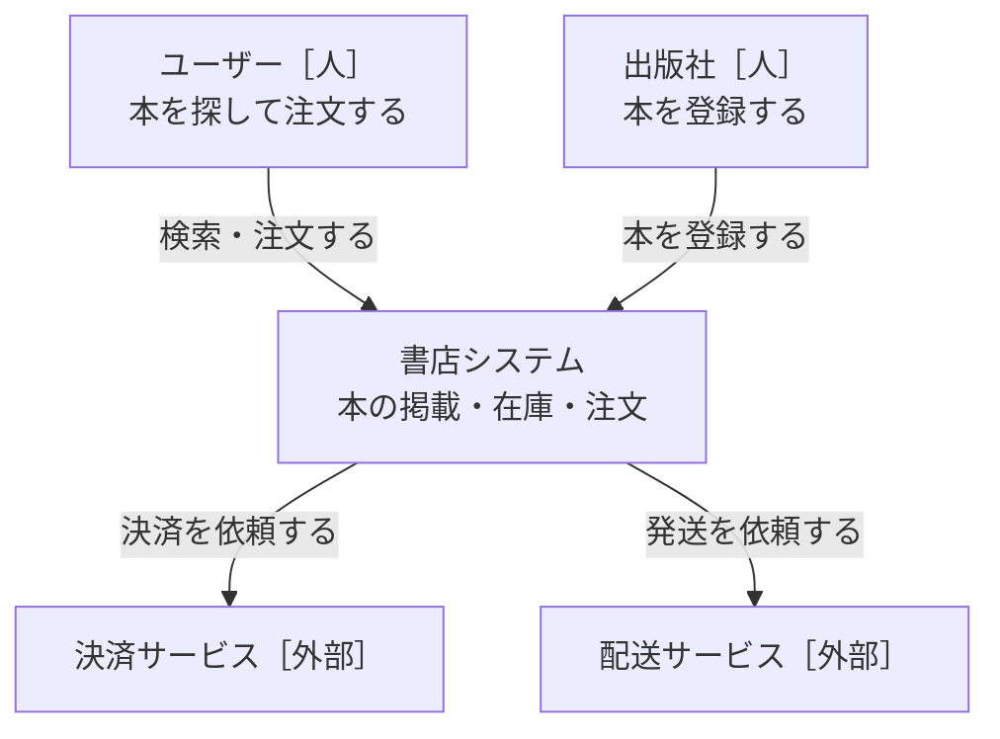
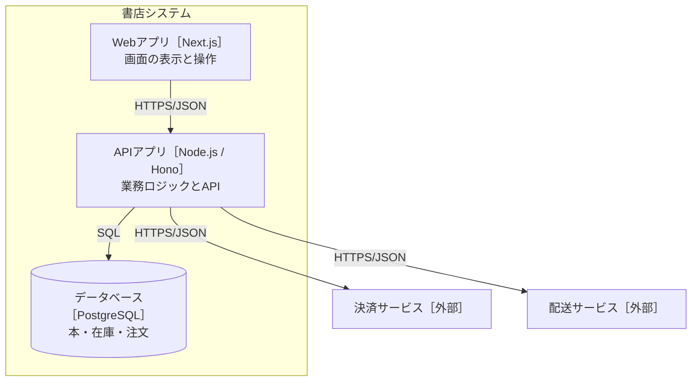
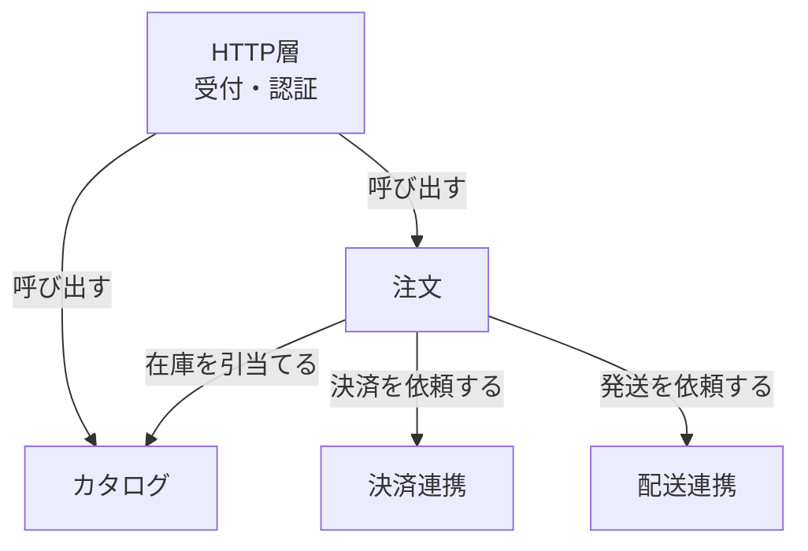

# 設計書：オンライン書店（記入例）

- PRD：./prd.md
- 状態：合意済み

## 1. 背景と目的
小さな出版社が本を直販できるオンライン書店を作る。
本の掲載・在庫管理・注文・決済・発送依頼までを1つのWebサービスで扱う。

## 2. やらないこと
- 電子書籍、複数倉庫、ポイント・クーポン
- 決済処理の自前実装（決済サービスに任せる）
- 管理画面の細かな権限分け（初版は運営者1人）

## 3. 全体図

### L1 システムコンテキスト

### L2 コンテナ

### L3 コンポーネント（APIアプリ）

## 4. コンポーネントと責務

### カタログ
- 責務：本の登録・更新・販売終了、検索、在庫数の管理と引当て
- 持つデータ（持ち主）：本、在庫
- 提供するAPI：Books 系、ReserveStock / ReleaseStock（内部）
- 依存するもの：データベース
- 配置：src/modules/catalog
- 完了の条件：
  - [ ] 在庫が0の本は ReserveStock が FAILED_PRECONDITION を返す
  - [ ] 同じ request_id の引当ては二重に在庫を減らさない
  - [ ] 検索はタイトル・著者の部分一致、page_size 最大100

### 注文
- 責務：注文の作成・確定・取消、注文履歴
- 持つデータ（持ち主）：注文
- 提供するAPI：Orders 系
- 依存するもの：カタログ（在庫引当て）、決済連携、配送連携
- 配置：src/modules/order
- 完了の条件：
  - [ ] 決済失敗・不明のとき在庫を戻し、注文は PAYMENT_FAILED / PAYMENT_PENDING になる
  - [ ] Idempotency-Key が同じ CreateOrder は同じ注文を返す
  - [ ] 本の情報は名前（publishers/{p}/books/{b}）で参照し、中身をコピーしない（注文時の価格のみ保存）

### 決済連携
- 責務：決済サービスとの通信を閉じ込める
- 持つデータ（持ち主）：なし
- 提供するAPI：Charge(amount, request_id)（内部）
- 依存するもの：決済サービス［外部］
- 配置：src/modules/payment
- 完了の条件：
  - [ ] タイムアウト10秒。タイムアウトは UNKNOWN として返す
  - [ ] 外部のエラーコードを業務のエラーに変換する

### 配送連携
- 責務：配送サービスへの発送依頼
- 持つデータ（持ち主）：なし
- 提供するAPI：RequestShipment(order)（内部）
- 依存するもの：配送サービス［外部］
- 配置：src/modules/shipping
- 完了の条件：
  - [ ] 失敗時は3回まで指数バックオフで再試行し、それでも失敗なら運営者に通知

## 5. API契約
詳細：./openapi.yaml

| コンポーネント | メソッド | エンドポイント | 概要 |
|---|---|---|---|
| カタログ | CreateBook | POST /publishers/{p}/books | 本を登録 |
| カタログ | GetBook | GET /publishers/{p}/books/{b} | 本を取得 |
| カタログ | SearchBooks | GET /books:search | 本を検索 |
| カタログ | ArchiveBook | POST /publishers/{p}/books/{b}:archive | 販売終了 |
| 注文 | CreateOrder | POST /users/{u}/orders | 注文を作成 |
| 注文 | ListOrders | GET /users/{u}/orders | 注文履歴 |
| 注文 | GetOrder | GET /users/{u}/orders/{o} | 注文を取得 |

### エラー方針
| コード | HTTP | 意味 | 呼び出し側の対応 |
|---|---|---|---|
| INVALID_ARGUMENT | 400 | 入力が不正 | 入力を直す |
| NOT_FOUND | 404 | 本・注文がない | 再試行しない |
| FAILED_PRECONDITION | 409 | 在庫不足・販売終了 | 画面で在庫切れを表示 |
| PAYMENT_FAILED | 402 | 決済が拒否された | 別の支払い方法を案内 |
| UNAVAILABLE | 503 | 一時的に使えない | バックオフして再試行 |

### 冪等性・タイムアウト
- CreateOrder・CreateBook は Idempotency-Key ヘッダ必須。同じキーなら同じ結果を返す
- 外部サービスのタイムアウト：決済10秒、配送5秒

## 6. デプロイ構成
| コンテナ | 実行環境 | 台数・複製 | 理由 |
|---|---|---|---|
| Webアプリ | Vercel | 自動 | 配信・証明書を任せる |
| APIアプリ | Cloud Run | 0〜2 | アクセスが少なく、待機費用を抑える |
| データベース | Neon（PostgreSQL） | 自動バックアップ | 運用を任せ、無料枠に収める |

- 秘密情報：決済のAPIキー・DB接続情報は Cloud Run の環境変数（Secret Manager）
- 停止の許容：夜間の数分停止は許容。注文データは日次バックアップ
- 費用の目安：月額 3,000円前後

## 7. 代替案とトレードオフ
| 論点 | 採用 | 不採用の案 | 理由 |
|---|---|---|---|
| 構成 | モジュラーモノリス | マイクロサービス | 1人運用。境界はモジュールで保ち、必要なら切り出す |
| 発送依頼 | 注文確定後に同期で依頼＋再試行 | イベントキュー | 件数が少なく、キュー運用の手間に見合わない |
| 在庫の一貫性 | 引当て時に即時確定 | 結果整合 | 在庫切れ注文0件が成功指標のため |

## 8. 未決事項
| 項目 | いつ・何をもとに決めるか |
|---|---|
| 返品の扱い | 公開後1か月の問い合わせ件数を見て決める |
