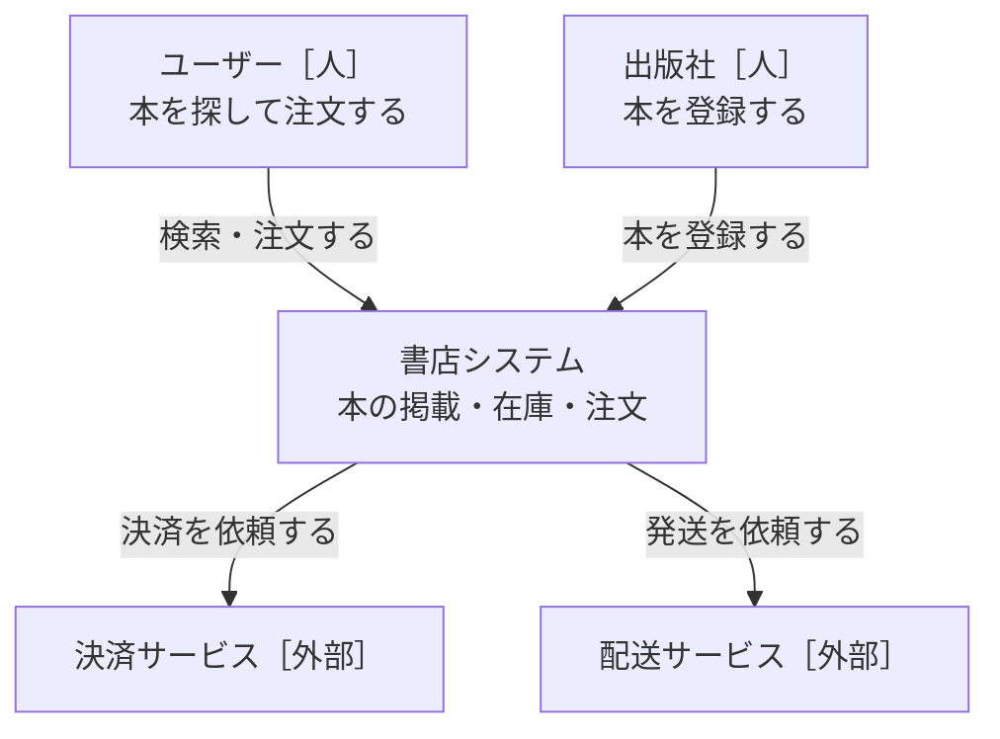
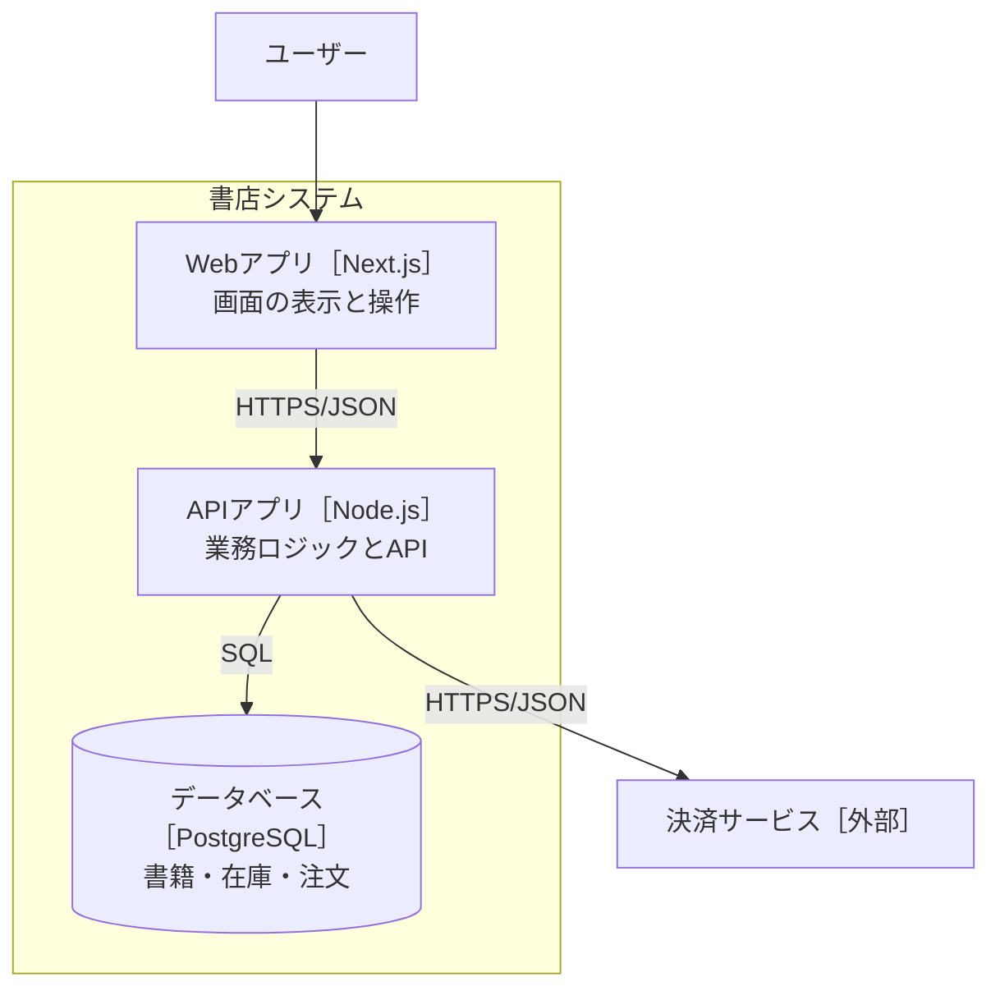
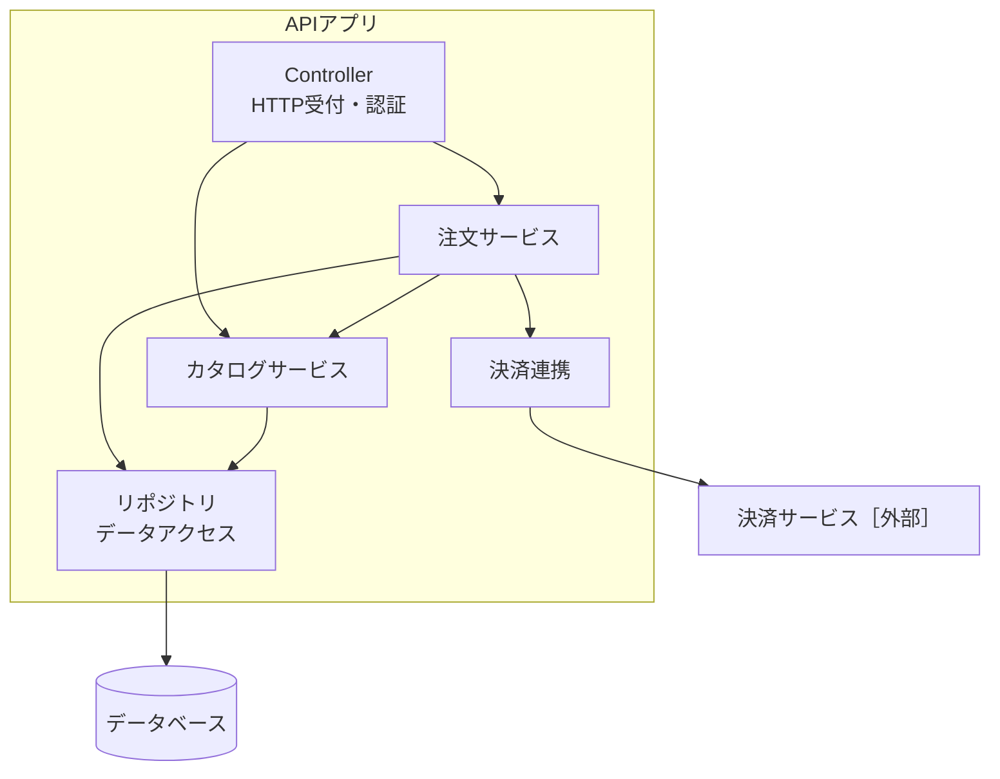
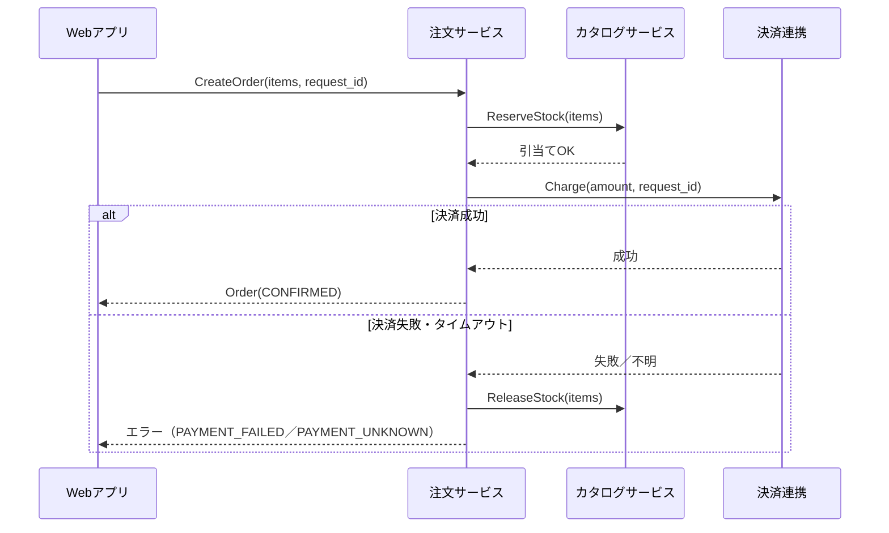

# C4モデルで図を描く

C4モデル（Simon Brown）は、システムを4つの縮尺で描く方法。地図アプリのズームと同じで、**縮尺ごとに必要な情報だけを描く**。
個人開発でも、AIエージェントは「読者の一人」。図はAIへの説明書になる。

## 縮尺と読者

| レベル | 図 | 主な読者 | 個人開発で |
|---|---|---|---|
| L1 | システムコンテキスト | 関係者全員（非エンジニア含む） | 必須 |
| L2 | コンテナ | 開発者・AIエージェント | 必須 |
| L3 | コンポーネント | 実装担当（人・AI） | コンテナ内が3つ以上の責務を持つなら描く |
| L4 | コード | 自分と自分のAI | 原則描かない |
| 補助 | 動的図（シーケンス） | 実装担当 | 処理順が重要な機能だけ |
| 補助 | デプロイ図 | 運用する人 | 本番環境を作るとき |

## L1 システムコンテキスト図

**答える問い**：誰が使うか／何のシステムか／どの外部システムとつながるか

- 描く：利用者（役割）、対象システム（1つの箱）、外部システム、やりとりの内容（動詞）
- 描かない：言語・フレームワーク・DB・内部構成
- よくある失敗：L1に「Next.js」「PostgreSQL」が出てくる → 縮尺の混在

## L2 コンテナ図

**コンテナ**＝システムが動くために実行されている必要があるもの（Dockerのコンテナとは別概念）。
例：サーバー側Webアプリ、ブラウザ上のSPA、モバイルアプリ、サーバーレス関数、バッチ、データベース、オブジェクトストレージ。

- 描く：コンテナ名［技術］、責務を1行、コンテナ間の通信方式（HTTPS/JSON、SQL、キューなど）
- 描かない：コンテナ内部のクラスやモジュール
- チェック：データベースを読み書きしているコンテナは1つか（複数なら持ち主を決める）

## L3 コンポーネント図

**コンポーネント**＝関連する機能のまとまりを、明確なインターフェースの裏に隠したもの。AIエージェントに作業を分ける単位。

- 描く：コンポーネント名、責務を1行、依存の向き、外部（DB・外部サービス）との接点
- 描かない：クラス・関数
- チェック：
  - 循環依存がないか（A→B→A）
  - DBに触るのはリポジトリ（データアクセス層）だけか
  - 外部サービス接続は専用のコンポーネント（アダプター）に閉じ込めているか

## 動的図（シーケンス）

処理の順番・失敗時の分岐が重要な機能だけ描く（決済、在庫引当てなど）。

## デプロイ図

どのコンテナを、どのサービス・リージョンに、いくつ置くか。

- 描く：実行環境（Vercel、Cloud Run、RDSなど）、台数・複製、ネットワーク境界
- 判断ポイント：1台構成で止まってよいか、どこまでマネージドに任せるか（`decision-guide.md` のトレードオフ参照）

## 図の品質チェック
- 各図に「縮尺（L1/L2/L3）」が明記されているか
- 箱に名前と責務（1行）があるか。名前だけの箱は読者が推測する
- 矢印にラベル（何を・どの方式で）があるか
- 1枚の箱は多くても10個程度。超えるなら分割するか縮尺を上げる
