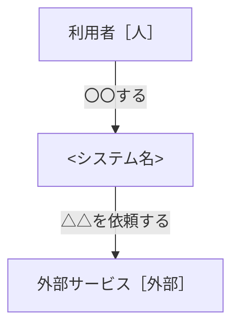
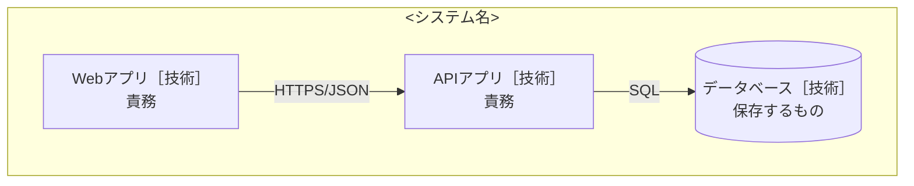

# 設計書：<システム名>

- PRD：<リンク>
- 作成者：
- 更新日：
- 状態：草案 / レビュー中 / 合意済み

## 1. 背景と目的
<!-- PRDの要約を3〜5行。このシステムで何を実現するか -->

## 2. やらないこと
<!-- スコープ外。AIエージェントが範囲を広げるのを防ぐ -->
- 

## 3. 全体図

### L1 システムコンテキスト
<!-- 誰が使い、どの外部システムとつながるか。技術名は書かない -->

### L2 コンテナ
<!-- 実行される単位と技術、通信方式 -->

## 4. コンポーネントと責務
<!-- コンポーネントごとに ### 見出しを1つ作る。make_handoff.py はこの見出し単位で抜き出す -->

### <コンポーネント名>
- 責務：
- 持つデータ（持ち主）：
- 提供するAPI：
- 依存するもの：
- 配置：<ディレクトリ例 src/modules/xxx>
- 完了の条件：
  - [ ] 

## 5. API契約
<!-- 詳細は docs/api/openapi.yaml。ここには一覧とエラー方針を書く -->

| コンポーネント | メソッド | エンドポイント | 概要 |
|---|---|---|---|
|  |  |  |  |

### エラー方針
| コード | HTTP | 意味 | 呼び出し側の対応 |
|---|---|---|---|
| INVALID_ARGUMENT | 400 | 入力が不正 | 入力を直す |
| NOT_FOUND | 404 | 対象がない | 再試行しない |
| FAILED_PRECONDITION | 409 | 状態が条件を満たさない | 状態を確認 |
| UNAVAILABLE | 503 | 一時的に使えない | バックオフして再試行 |

### 冪等性・タイムアウト
- 作成系は `request_id` を受け取り、同じIDなら同じ結果を返す
- タイムアウト：

## 6. デプロイ構成
| コンテナ | 実行環境 | 台数・複製 | 理由 |
|---|---|---|---|
|  |  |  |  |

- 秘密情報の置き場所：
- バックアップ・停止の許容：
- 費用の目安：

## 7. 代替案とトレードオフ
| 論点 | 採用 | 不採用の案 | 理由 |
|---|---|---|---|
|  |  |  |  |

## 8. 未決事項
| 項目 | いつ・何をもとに決めるか |
|---|---|
|  |  |
