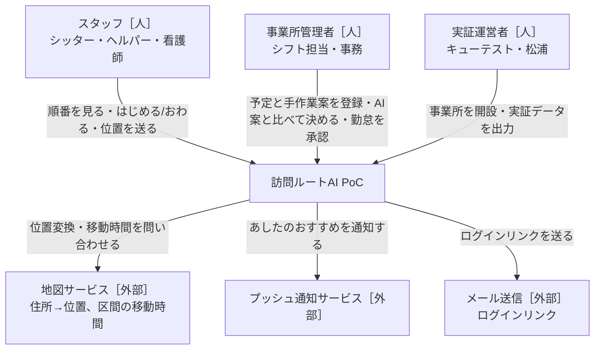
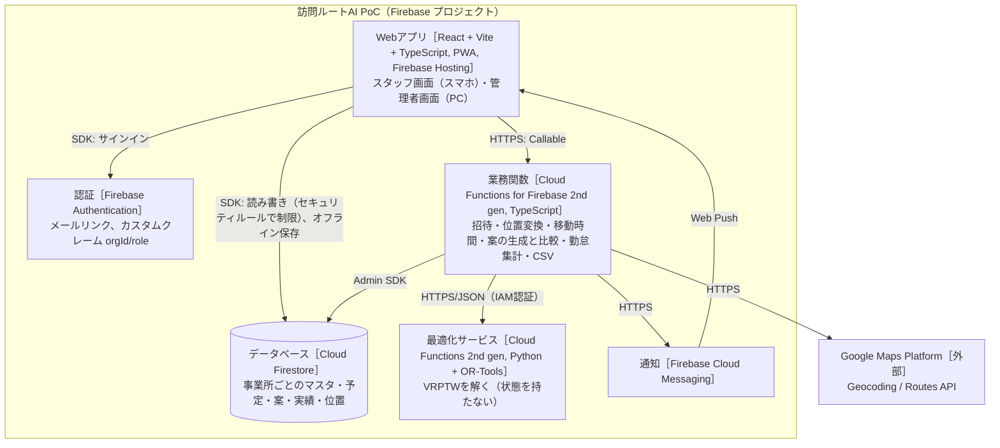
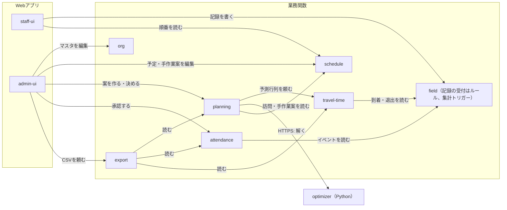

# 設計書：訪問ルートAI PoC（仮称）

- PRD：[docs/prd.md](prd.md)
- 作成者：中原・松浦（草案：Claude）
- 更新日：2026-10-10
- 状態：合意済み（2026-10-10。α版＝10月末、最小構成は PRD §9）

## 1. 背景と目的

仙台市の実証事業（3事業所×4件、2回構成）で協力法人に使ってもらう、訪問型サービス向けのPoCアプリ。
スタッフは本人のスマホ（PWA）できょうの順番を見て「はじめる」「おわる」を押し、位置情報から到着・退出の候補と勤怠集計が作られる。
管理者は1日の訪問予定と手作業の割当・順番を登録し、AIが作る案（移動時間予測＋割当と順番の最適化）と比べて決める。
実証データ（予測と実測・TTS・手作業案とAI案の計画値）を仮名IDでCSVに出し、KPI（移動時間20〜30%削減、予測誤差±10分以内90%）を判定する。
Firebase（Firestore）中心で、少ない工数（150h）で作り切ることを最優先する。

## 2. やらないこと

- 請求・実績記録票・利用者サイン、業種別の記録テンプレート、日報・カルテの生成AI（案D-3「きろく」）
- 給与計算、既存の勤怠・給与・請求システムとのAPI連携、勤怠の自動確定
- 急なキャンセル時の自動再配置、LINE連携、空き枠の可視化、相性の学習（NG登録のみ）
- 月次シフトの一括自動作成（AI案は1日単位）
- ネイティブアプリ、バックグラウンドでの常時位置追跡（PWAの制約。ADR-0002）
- `katahimo-app`（PostgreSQL版）とのデータ連携・コード共有。画面の考え方だけ参考にする
- 要配慮個人情報（障害の内容・病状・介護度）の保存

## 3. 全体図

### L1 システムコンテキスト

### L2 コンテナ

通信の原則：
- 画面は自分の事業所のデータを Firestore SDK で直接読む（リアルタイム・オフライン対応）。
- 画面が直接書くのは「スタッフ本人の記録（イベント・位置）」と「管理者のマスタ・予定・手作業案」だけ。どちらもセキュリティルールで持ち主と型を検査する。
- 判定・計算・外部APIを伴う書き込み（招待、位置変換、移動時間、AI案、比較、勤怠集計、CSV）は業務関数だけが行う。画面からは書けない。

### L3 コンポーネント

矢印は「読む・呼ぶ」。データを書き換えるのは各コンポーネントが持ち主のデータだけ（§4）。

## 4. コンポーネントと責務

データはすべて `orgs/{orgId}/{collection}` の下に置く（事業所の分離。ADR-0001）。以下のコレクション名は `orgs/{orgId}` からの相対。

### org（事業所・スタッフ・訪問先）
- 責務：事業所の設定（業種・呼び方・最適化モード `order_only | assign_and_order`・交通費単価・ジオフェンス半径）、スタッフと訪問先のマスタ、ユーザー招待とロール付与、住所→緯度経度の変換と訂正、CSV取込。
- 持つデータ（持ち主）：事業所設定（`orgs/{orgId}` 本体）、`staff`（氏名・性別・自宅位置・移動手段・勤務曜日と時間・uid）、`clients`（表示名・住所・位置・性別希望・NGスタッフ・メモ）、`analysisIds`（仮名ID対応表。運営者のみ読める）
- 提供するAPI：`inviteMember`、`geocodeAddress`、`importMasterCsv`（Callable）。マスタの通常の編集は画面から直接（ルールで admin のみ）。
- 依存するもの：Firebase Auth（カスタムクレーム）、Google Geocoding API。
- 配置：`functions/src/modules/org/`、`web/src/features/admin/master/`
- 完了の条件：
  - [ ] 招待したメールでメールリンクログインでき、クレーム `orgId`/`role` が付く
  - [ ] 別事業所のユーザーが `orgs/{他}` を読めない（ルールのエミュレーターテスト）
  - [ ] 住所変換に失敗しても保存でき、地図上でピンを動かして訂正できる
  - [ ] 業種設定でシッター専用の表示が出ない（呼び方が切り替わる）

### schedule（予定・手作業案）
- 責務：繰り返し予定（契約：曜日・時間）から日々の訪問を作る、1日の訪問の登録・変更・キャンセル、**手作業の割当・順番（manual plan）**の保存。スタッフにはその日の決定済みの順番を見せる。
- 持つデータ（持ち主）：`recurringVisits`（契約の曜日・時間）、`visits`（日付・訪問先・時間の約束 fixed または window・開始幅・所要時間・必要条件・現在の担当）、`manualPlans`（日付ごと。スタッフ別の訪問ID列、作成にかかった分数）
- 提供するAPI：`generateDayVisits(date)`（Callable、繰り返し予定から展開。同じ日を再実行しても重複しない）。それ以外の編集は画面から直接（ルールで admin のみ）。スタッフ画面は planning の `decidedPlans` があればそれを、なければ `manualPlans` を表示する。
- 依存するもの：org（スタッフ・訪問先）。
- 配置：`functions/src/modules/schedule/`、`web/src/features/admin/schedule/`
- 完了の条件：
  - [ ] 1日3件以上の訪問と、手作業の割当・順番を登録できる（受入1）
  - [ ] 繰り返し予定の展開を2回実行しても訪問が二重にならない
  - [ ] 決定済みの順番がない日は、手作業案をスタッフに見せる（1回目の実証）

### travel-time（移動時間予測AI）
- 責務：区間（出発地→到着地・移動手段・時間帯）の**基準移動時間**を地図APIで取り、実測から作った補正で**予測移動時間**を返す。実測区間の収集と、補正モデルの学習・版管理。
- 持つデータ（持ち主）：`legCache`（基準値、30日）、`travelModels`（補正係数表＝時間帯×曜日区分×移動手段×距離帯→倍率、学習に使った件数）、`legActuals`（実測区間＝前の退出→次の到着、予測値・基準値・モデル版つき）
- 提供するAPI：内部関数 `predictMatrix(points, mode, departBand) → {seconds[][], meters[][], modelVersion}`（planning から呼ぶ）、`trainModel()`（Callable、運営者のみ。α は係数表、改で1回目の実データから再学習）。
- 依存するもの：Google Routes API（Compute Route Matrix）、field（実測の到着・退出）。
- 配置：`functions/src/modules/travel-time/`、学習ノートブックは `analysis/`
- 完了の条件：
  - [ ] 同じ区間は30日間キャッシュから返し、地図APIを呼ばない
  - [ ] 実測区間に予測値・基準値・モデル版が残り、誤差±10分以内の割合を集計できる
  - [ ] モデル版を指定すると同じ入力から同じ予測が返る

### optimizer（訪問の割当と順番の最適化）
- 責務：入力（スタッフの出発地・勤務時間・移動手段、訪問の位置・時間の約束・所要時間・性別希望・NG、移動時間行列、モード）から、絶対条件を守る割当と順番を返す。守れない訪問は「未割当」とし、原因の条件を返す。状態を持たない。
- 持つデータ（持ち主）：なし
- 提供するAPI：`POST /v1/plans:solve`（docs/api/openapi.yaml）。
- 依存するもの：なし（OR-Tools Routing。ADR-0003）。
- 配置：`optimizer/`（Python）
- 完了の条件：
  - [ ] `order_only` では割当を変えず、順番だけを変える
  - [ ] 時間の約束・勤務時間・性別希望・NG を破る案を返さない（テストで保証）
  - [ ] 同じ入力で同じ結果（探索は解の数で打ち切り、単一スレッド・固定シード）
  - [ ] 1事業所1日（スタッフ8人・訪問30件）を30秒以内に返す
  - [ ] 守れない訪問に原因（`time_window` / `shift` / `gender` / `ng_staff` / `unreachable`）が付く

### planning（AI案の生成・比較・決定）
- 責務：その日の訪問・スタッフ・予測行列を集めて optimizer を呼び、**AI案**として保存。手作業案とAI案を同じ予測行列で再計算して比較（移動時間・距離・交通費・待ち時間・条件違反）。管理者の手直しと決定、理由の記録。前夜の自動生成とおすすめ通知（改）。
- 持つデータ（持ち主）：`planRuns`（入力のスナップショット・モデル版・ソルバー版・結果＝AI案・計算時間）、`comparisons`（日付×実行ごと）、`decidedPlans`（日付ごと。決定案・決定者・理由・元にした案）、`recommendations`（日付×スタッフ。通知と返答）
- 提供するAPI：`createPlanRun(date)`、`comparePlans(date, runId)`、`decidePlan(date, base, edits, reason)`、`respondRecommendation(id, answer)`（Callable）。スケジュール関数 `nightlyPlan`（毎晩、翌日分。1回目は通知しない）。
- 依存するもの：schedule、travel-time、optimizer、org、FCM。
- 配置：`functions/src/modules/planning/`、`web/src/features/admin/planning/`
- 完了の条件：
  - [ ] 1回目の実証期間中、AI案は保存されるだけでスタッフ画面に出ない（事業所設定 `showAiToStaff=false`）
  - [ ] `decidedPlans` を書くのは planning だけ（schedule の `visits` の担当は書き換えない）
  - [ ] 比較は手作業案とAI案を**同じ行列**で計算する（計画値比較）
  - [ ] AIは `decided` を自動で書かない。`decidePlan` だけが書き、理由が必須
  - [ ] `planRuns` から同じ比較結果を再計算できる（受入10）

### field（スタッフの記録：勤務・位置・はじめる/おわる）
- 責務：勤務の開始・終了（＝位置計測の開始・終了）、画面の開閉（顧客情報・経路：T1/T2）、位置サンプル、端末側ジオフェンスによる到着・退出の検知（T3）、はじめる・おわる（T4・実績）。オフライン時は Firestore のオフライン保存で端末に残し、復帰後に送る。
- 持つデータ（持ち主）：`events`（種別・訪問ID・端末時刻・受信時刻・位置精度。文書IDは端末で生成した UUID で、再送しても同じ文書になる）、`locationSamples`（スタッフ×日付。勤務中のみ、間引き済み、実証後に削除）
- 提供するAPI：画面からの直接書き込み（ルール：本人の `staffId`、作成のみ・更新削除不可、種別の列挙を検査）。トリガー `onEventCreated` で attendance と travel-time に渡す。
- 依存するもの：ブラウザの Geolocation API、schedule（その日の順番と訪問先の位置）。
- 配置：`web/src/features/staff/field/`、`functions/src/modules/field/`
- 完了の条件：
  - [ ] 勤務中以外は位置を取らず、取っている間は画面に表示が出る
  - [ ] 機内モードで「はじめる」→復帰後に1件だけ届く（受入7）
  - [ ] T1〜T4 がイベントとして記録される（受入5）
  - [ ] アプリを閉じていた間の到着は「はじめる」時刻で補い、補った印を残す

### attendance（勤怠候補・承認・集計）
- 責務：イベントから訪問ごとの到着・開始・終了・退出の**候補**を作り、日ごとに実働・移動・休憩（訪問間の移動以外の空き）・拘束時間を集計。本人の訂正、管理者の承認、CSV出力。自動確定しない。
- 持つデータ（持ち主）：`attendanceDays`（スタッフ×日付。訪問ごとの候補と訂正値・訂正理由・状態 candidate→confirmed_by_staff→approved・集計値・version）
- 提供するAPI：`correctAttendance(id, patch, version)`（本人）、`approveAttendance(id, version)`（admin）、`exportAttendanceCsv(month)`（admin）（Callable）。
- 依存するもの：field（イベント）、schedule（予定時刻＝予実の「予」）。
- 配置：`functions/src/modules/attendance/`、`web/src/features/staff/attendance/`、`web/src/features/admin/attendance/`
- 完了の条件：
  - [ ] 予定と実績を別々に持ち、ずれた訪問に「変更あり」が付く
  - [ ] 訂正の前の値と理由が残る。承認済みは本人が訂正できない
  - [ ] 同時に訂正と承認が来ても後勝ちで消えない（version 不一致は `FAILED_PRECONDITION`）

### export（実証データ出力）
- 責務：事業所別・ケース別に、予測と実測、TTS（T1〜T4）、ルート作成時間、手作業案とAI案の計画値、採用・手直し回数を、**仮名ID**で CSV に出す。
- 持つデータ（持ち主）：なし
- 提供するAPI：`exportStudyData(orgId?, from, to)`（Callable、運営者のみ）。
- 依存するもの：planning、attendance、travel-time、org（仮名ID対応表）。CSVは Cloud Storage に一時保存（署名付きURL 1時間、1日で削除）。
- 配置：`functions/src/modules/export/`
- 完了の条件：
  - [ ] 出力に氏名・住所・電話が含まれない
  - [ ] 同じ期間で2回出すと同じ内容になる

### staff-ui（スタッフのスマホ画面）
- 責務：ログイン、勤務開始・終了、きょうの回る順番（地図＋順番＋区間時間＋到着予測）、顧客情報・経路を開く、はじめる/おわる、到着・退出の確認と訂正、あしたのおすすめ（改）、移動中の画面（任）。画面案「ルート最適化 スタッフのスマホ画面」の構成に、案D-3の見た目（白い枠・主ボタンはオレンジ1色・利用者は色の丸）を当てる。
- 持つデータ（持ち主）：なし
- 提供するAPI：なし。
- 依存するもの：field、schedule、attendance、planning（おすすめ）。
- 配置：`web/src/features/staff/`
- 完了の条件：
  - [ ] 1画面の主ボタンは1つ（多くて2つ）。文字は大きく短く
  - [ ] iPhone（ホーム画面に追加）と Android の Chrome で動く

### admin-ui（管理者のPC画面）
- 責務：マスタ・予定・手作業案の登録、AI案との比較画面（画面案「ルート最適化 管理者のパソコン画面」）、手直しと決定、勤怠の承認、CSV出力。
- 持つデータ（持ち主）：なし
- 提供するAPI：なし。
- 依存するもの：org、schedule、planning、attendance、export。
- 配置：`web/src/features/admin/`
- 完了の条件：
  - [ ] 手作業案の入力が、スタッフ列への並べ替え（ドラッグ）だけでできる
  - [ ] 比較画面に、手作業は点線・AIは実線、チーム全体の削減率と目標20〜30%の線が出る

## 5. API契約

詳細は `docs/api/openapi.yaml`。Callable は Firebase の `httpsCallable`（POST、Firebase ID トークン必須）で、表のパスは関数名。Firestore への直接読み書きの契約は `firestore.rules` と `packages/shared/src/schema/`（zod）を正とする。

| コンポーネント | メソッド | エンドポイント | 概要 |
|---|---|---|---|
| org | Callable | `inviteMember` | メールとロールで招待し、クレームを付ける（admin / operator） |
| org | Callable | `geocodeAddress` | 住所→緯度経度（候補を返す。保存は画面） |
| org | Callable | `importMasterCsv` | スタッフ・訪問先CSVの取込（dry-run → 適用） |
| schedule | Callable | `generateDayVisits` | 繰り返し予定から指定日の訪問を作る（冪等） |
| travel-time | Callable | `trainModel` | 実測から補正モデルの新しい版を作る（operator） |
| planning | Callable | `createPlanRun` | 指定日のAI案を作る |
| planning | Callable | `comparePlans` | 手作業案とAI案を同じ行列で比較 |
| planning | Callable | `decidePlan` | 手直しした案を決定し理由を残す |
| planning | Callable | `respondRecommendation` | スタッフがおすすめに返答（改） |
| attendance | Callable | `correctAttendance` | 本人が勤怠候補を訂正 |
| attendance | Callable | `approveAttendance` | 管理者が承認 |
| attendance | Callable | `exportAttendanceCsv` | 勤怠CSV（月） |
| export | Callable | `exportStudyData` | 実証データCSV（仮名ID） |
| optimizer | POST | `/v1/plans:solve` | VRPTW を解く（業務関数からのみ。IAM） |

### エラー方針

Callable は `HttpsError` のコードで返す。`message` は利用者向けの日本語、`details.reason` に業務上の理由コード。

| コード | HTTP | 意味 | 呼び出し側の対応 |
|---|---|---|---|
| INVALID_ARGUMENT | 400 | 入力が不正（`details.fields` に項目） | 入力を直す |
| UNAUTHENTICATED | 401 | 未ログイン | ログインし直す |
| PERMISSION_DENIED | 403 | ロール・事業所が違う | 再試行しない |
| NOT_FOUND | 404 | 対象がない | 再試行しない |
| FAILED_PRECONDITION | 409 | 状態が条件を満たさない（version 不一致・承認済み・手作業案が未登録） | 読み直してやり直す |
| RESOURCE_EXHAUSTED | 429 | 地図APIの日次上限・連打 | 時間をおく |
| UNAVAILABLE | 503 | 地図API・最適化サービスが一時的に使えない | バックオフして再試行 |
| INTERNAL | 500 | 想定外（詳細はログのみ） | 再試行しない |

optimizer の「守れない訪問がある」はエラーではなく、成功応答の `unassigned[]` に原因つきで返す。

### 冪等性・タイムアウト
- 作成系 Callable（`createPlanRun`・`decidePlan`・`importMasterCsv` 適用・`generateDayVisits`）は `requestId` を受け取り、同じIDなら最初の結果を返す（`requests/{requestId}` に記録）。
- スタッフの記録は端末生成の `eventId` を文書IDにするので、再送は同じ文書の作成になり二重にならない（ルールで更新を禁止）。
- タイムアウト：Callable 60秒（`createPlanRun` は 120秒）、optimizer 30秒（打ち切り時は `UNAVAILABLE` ではなく途中までの最良解に `partial: true`）、地図API 10秒×再試行2回。

## 6. デプロイ構成

| コンテナ | 実行環境 | 台数・複製 | 理由 |
|---|---|---|---|
| Webアプリ | Firebase Hosting（CDN） | — | 静的配信、PWA、無料枠で足りる |
| 認証 | Firebase Authentication | — | メールリンクが標準機能。カスタムクレームで事業所とロール |
| データベース | Cloud Firestore（asia-northeast1、Native） | — | オフライン保存・リアルタイム・ルールで事業所分離。運用ゼロ |
| 業務関数 | Cloud Functions 2nd gen（Node 22、asia-northeast1） | 最小0・最大10 | 利用は実証時間帯だけ。待機費用なし |
| 最適化サービス | Cloud Functions 2nd gen（Python 3.12、asia-northeast1、メモリ1GiB） | 最小0・最大3、外部公開なし（呼び出しは業務関数のサービスアカウントのみ） | OR-Tools は Python が扱いやすい。Firebase CLI で同じリポジトリから一緒にデプロイ（codebase 分割） |
| 通知 | Firebase Cloud Messaging | — | Web Push（iOS はホーム画面追加が前提） |
| 一時ファイル | Cloud Storage for Firebase | — | CSV。1日で自動削除 |

- 環境：`dev`（エミュレーター＋開発用プロジェクト）と `poc`（実証用）の2プロジェクト。
- 秘密情報の置き場所：Maps APIキー（サーバー用）は Secret Manager（`defineSecret`）。画面用の地図表示キーは HTTP リファラ制限つきで別キー。
- バックアップ・停止の許容：Firestore の日次エクスポート（Cloud Storage、30日保持）。停止は実証時間帯以外なら許容。障害時は紙・LINEの従来運用に戻す（業務を止めない）。
- 位置データの削除：`locations` は実証終了後に一括削除（期限は市・協力先と合意）。勤怠・実測区間は位置の生データを持たない。
- 費用の目安：Firebase は無料枠〜月数百円。地図API は 1事業所1日（地点約40）の行列で約1,600要素×時間帯3＝月20日×3事業所で約30万要素 → キャッシュ前の上限で数万円/月。予算 220,000円以内に収まるよう、日次上限（クォータ）を設定する。

## 7. 代替案とトレードオフ

| 論点 | 採用 | 不採用の案 | 理由 |
|---|---|---|---|
| データ基盤 | Firestore（ADR-0001） | PostgreSQL（katahimo-app と同じ Cloud SQL） | 150hで作り切る。オフライン再送・リアルタイム・認証が標準。集計は少量なので関数で足りる。代わりに複雑な集計・結合はできず、CSVで外に出して分析する |
| 事業所の分離 | `orgs/{orgId}` 配下＋カスタムクレーム＋ルール | 事業所ごとに Firebase プロジェクト | 3事業所なら1プロジェクトで十分。ルールのテストで分離を保証 |
| 最適化の対象 | 割当＋順番（VRPTW、事業所ごとにモード） | 順番のみ（提案書どおり） | alca は時間固定で順番の自由度が小さい（PRD §0） |
| ソルバー | OR-Tools Routing（ADR-0003） | CP-SAT で自前に定式化／自作ヒューリスティック | VRPTW・割当・時間枠が標準機能。CP-SAT・QUBO は比較手法としてオフラインで使う |
| 位置計測 | PWA の前景計測＋ボタン時点（ADR-0002） | ネイティブアプリ（Capacitor）でバックグラウンド計測 | 配布・審査・工数。精度不足が1回目で分かれば改修で Capacitor 化を検討 |
| ジオフェンス判定 | 端末側（位置と訪問先の距離） | サーバー側で位置サンプルから判定 | オフラインでも即時に候補を出せる。サーバーは訂正・承認の正を持つ |
| 移動時間予測 | 地図APIの基準×補正係数表（α）→ 実データで回帰（改） | 最初から機械学習モデル | 学習データ（実測区間）は1回目で初めて溜まる。係数表なら版管理と再現が簡単 |
| 画面からの書き込み | マスタ・予定・記録はSDK直接、判定・計算は関数 | すべて関数経由 | 工数とオフライン対応。ルールで型と持ち主を検査する |

## 8. 未決事項

| 項目 | いつ・何をもとに決めるか |
|---|---|
| フォール様の要件差分（記録する時刻・時間の約束・呼び方） | 10/15 ヒアリング後。土台（org・schedule・field）は先行して作る |
| PWAの位置計測で到着・退出の精度が足りるか | 社内（Family Sitter®）の先行試験1週間の結果で。足りなければ Capacitor 化 |
| 予定の取り込み（アプリ登録のみ／Googleカレンダー／RESERVA） | 協力法人ごとの説明会前。alca は Googleカレンダー運用 |
| 休憩の定義（訪問間の空き−予測移動時間か、本人申告か） | alca と労務の考え方を確認して |
| 改修版の優先順位（比較画面 → おすすめ通知 → 比較手法） | 11月中旬のヒアリング② |
| 割当モードを2回目に現場で試すか（1回目は裏で比較のみ） | 1回目の比較結果と、管理者の受け止めを見て |
| 位置データの削除期限 | 市・協力先との合意 |
